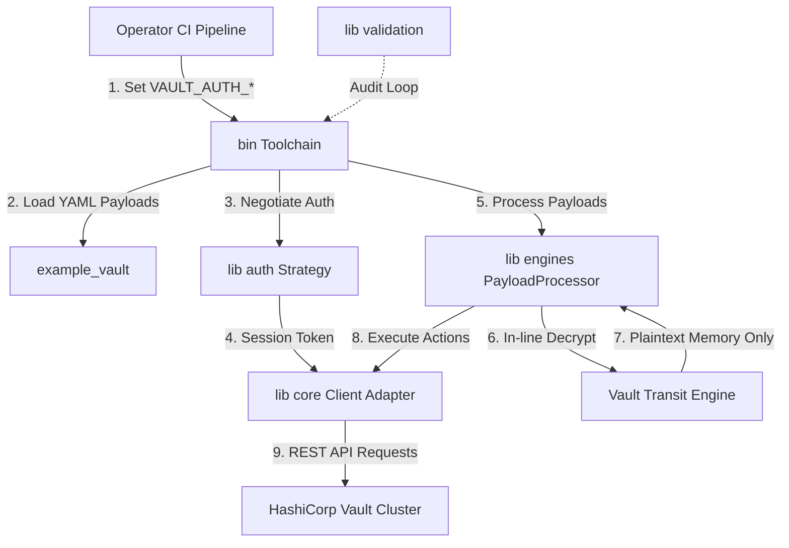

# HashiCorp Vault State Controller

This repository contains automation logic wrapping the Vault CLI and API to maintain the desired state for any given HashiCorp Vault Cluster. The core engine performs writes against the cluster using YAML manifests found in the `config/example_vault` folder. 

Crucially, the suite can ingest **Vault Transit** encrypted data within the repository and perform in-line decryption prior to execution. This allows teams to practice complete **Infrastructure as Code (IaC)** patterns without ever committing plain-text sensitive data to source control. 

This repository is designed to be utilized directly from a CI/CD orchestrator (GitHub Actions, GitLab CI) against any target Vault cluster. The engine is built to be resilient, ignoring redundant warnings (such as secret engines that are already enabled) while performing subsequent idempotent writes to all other resources.



## Key Technical Breakthroughs
- **Strategy-Based Auth**: Support for AWS IAM, GCP Workload Identity, LDAP, and AppRole using unified `VAULT_AUTH_*` environment variables.
- **In-Repo Secret Safety**: Sensitive data is committed as **Vault Transit Ciphertext**, decrypted in volatile memory only during deployment via the `PayloadProcessor`.
- **Modular Library**: Decoupled core client (`lib/core`), engine processors (`lib/engines`), and business-logic validation managers (`lib/validation`).

## Requirements
*   **Python 3.10+** (Mandatory)
*   **HashiCorp Vault Binary** (v1.15+)
*   **Gemini / Claude** (Optional, for GPU-accelerated assistance)

## Quick Start: CLI Usage

To interact with a Vault cluster, configure your unified authentication variables and use the `bin/` toolchain.

```bash
# 1. Define Unified Auth (Example: AWS IAM)
export VAULT_AUTH_TYPE="aws"
export VAULT_AUTH_PRINCIPAL="my-automation-role"

# 2. Deploy Configuration Payloads (YAML)
# Automatically handles in-line Transit decryption
python3 bin/cluster_secret_data.py --name example_vault --path ./config/example_vault/admin/
```

### Supported Auth Strategies
- **AWS**: `VAULT_AUTH_TYPE=aws` (Uses Boto3 STS signed requests)
- **GCP**: `VAULT_AUTH_TYPE=gcp` (Uses GCP Metadata JWTs)
- **LDAP**: `VAULT_AUTH_TYPE=ldap`, `VAULT_AUTH_PRINCIPAL=username`, `VAULT_AUTH_SECRET=password`
- **Token**: `VAULT_AUTH_TYPE=token`, `VAULT_AUTH_SECRET=hvs...`

## Automated Testing (TDD)

We enforce 100% functional parity through `pytest`. The suite includes unit tests for core logic and integration tests against a containerized `vault server -dev` environment.

```bash
# Set PYTHONPATH to include local lib
export PYTHONPATH=$PYTHONPATH:$(pwd)/projects/vault_controller

# Run the full suite
pytest projects/vault_controller/tests/
```

## Contributing

Contributions are welcome! Please see [CONTRIBUTING.md](CONTRIBUTING.md) for details on how to get started.

## License

This project is licensed under the MIT License - see the [LICENSE](LICENSE) file for details.
