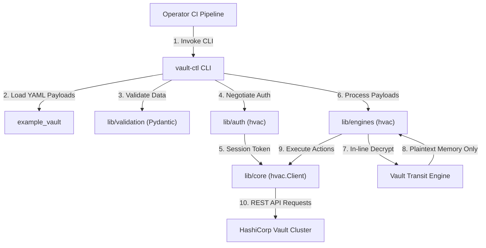

# HashiCorp Vault State Controller

This repository contains automation logic for maintaining the desired state for any given HashiCorp Vault Cluster. The core engine is refactored to use the official **hvac** Python library and **pydantic** for robust, declarative data validation.

Crucially, the suite can ingest **Vault Transit** encrypted data within the repository and perform in-line decryption prior to execution. This allows teams to practice complete **Infrastructure as Code (IaC)** patterns without ever committing plain-text sensitive data to source control. 



## Key Technical Breakthroughs
- **Hvac-Powered Core**: Replaces custom HTTP adapters with the official HashiCorp `hvac` library for improved stability and access to native Vault APIs.
- **Pydantic Validation**: Uses typed models to enforce payload schemas and complex business logic (e.g., TTL limits, namespace directory isolation) before network calls.
- **Modern CLI**: Consolidated toolchain into a single, user-friendly `vault-ctl` command powered by **Typer** and **Rich**.
- **In-Repo Secret Safety**: Sensitive data is committed as **Vault Transit Ciphertext**, decrypted in volatile memory only during deployment via the `PayloadProcessor`.

## Requirements
*   **Python 3.10+** (Mandatory)
*   **HashiCorp Vault Binary** (v1.15+)
*   **Dependencies**: `hvac`, `pydantic`, `typer`, `rich`, `PyYAML`, `requests`

## Quick Start: CLI Usage

The primary entry point is the consolidated `vault-ctl` CLI. Ensure the project root is in your `PYTHONPATH`.

```bash
export PYTHONPATH=$PYTHONPATH:$(pwd)

# Check cluster status
python3 projects/vault_controller/bin/vault_ctl.py cluster status --name example_vault

# Deploy configuration payloads (YAML)
# Automatically handles validation and in-line Transit decryption
python3 projects/vault_controller/bin/vault_ctl.py secrets deploy \
  --name example_vault \
  --path ./projects/vault_controller/config/example_vault/admin/
```

### Supported Auth Strategies
- **AWS**: `VAULT_AUTH_TYPE=aws` (Uses `hvac` IAM login)
- **GCP**: `VAULT_AUTH_TYPE=gcp` (Uses `hvac` GCP login with Metadata JWTs)
- **LDAP**: `VAULT_AUTH_TYPE=ldap`, `VAULT_AUTH_PRINCIPAL=username`, `VAULT_AUTH_SECRET=password`
- **Token**: `VAULT_AUTH_TYPE=token`, `VAULT_AUTH_SECRET=hvs...`

## Automated Testing (TDD)

We enforce 100% functional parity through `pytest`. The suite includes unit tests for core logic and integration tests against a containerized `vault server -dev` environment.

```bash
# Run the full suite
pytest projects/vault_controller/tests/
```

## Contributing

Contributions are welcome! Please see [CONTRIBUTING.md](CONTRIBUTING.md) for details on how to get started.

## License

This project is licensed under the MIT License - see the [LICENSE](LICENSE) file for details.
