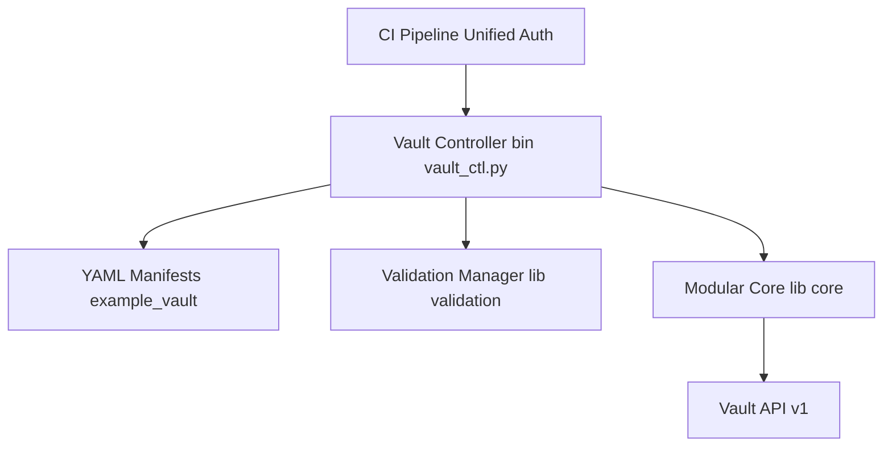

# Breaking the Global Lock: The Shift to Stateless, Data-Driven Vault Orchestration

For years, the standard playbook for managing HashiCorp Vault configurations has been static: spin up a HashiCorp Configuration Language (HCL) repository, drag in the official Terraform Vault provider, and wire up your authentication backends, secret engines, and policies through a centralized continuous integration (CI) runner. This stateful infrastructure-as-code (IaC) model was a massive upgrade from the wild-west era of manual scripting and curl commands. 

Yet, as platform teams scale out multitenant clusters across hundreds of autonomous engineering pods, this paradigm reveals structural friction points. The standard approach forces a hard operational choice: either give developers direct commit rights to a massive, monolithic Terraform state file—inviting state-locking gridlock and massive blast radiuses—or position the platform team as a human ticketing queue, manually vetting HCL pull requests for basic key-value paths and role creations.

To break this bottleneck, modern platform engineering teams are increasingly shifting toward data-driven, localized schema definitions decoupled from infrastructure state lifecycles. This deep dive evaluates the architectural mechanics, threat models, and explicit code implementations of an enterprise-grade, Python-driven, stateless automation suite designed to replace stateful HCL frameworks for day-2 Vault management.

---

## Content

- [Breaking the Global Lock: The Shift to Stateless, Data-Driven Vault Orchestration](#breaking-the-global-lock-the-shift-to-stateless-data-driven-vault-orchestration)
  - [Content](#content)
  - [The Chronological Failure of Stateful Secret Management](#the-chronological-failure-of-stateful-secret-management)
    - [Phase 1: The ClickOps and Shell Scripting Baseline](#phase-1-the-clickops-and-shell-scripting-baseline)
    - [Phase 2: The Terraform State Paradigm and Its Limits](#phase-2-the-terraform-state-paradigm-and-its-limits)
    - [Phase 3: The Custom Blueprint Crackup](#phase-3-the-custom-blueprint-crackup)
    - [Phase 4: Stateless Schema Automation](#phase-4-stateless-schema-automation)
    - [Phase 5: The Packaging Frontier](#phase-5-the-packaging-frontier)
  - [Architectural Blueprint \& The Strategy Pattern](#architectural-blueprint--the-strategy-pattern)
    - [The Strategy Pattern for Multi-Cloud Auth](#the-strategy-pattern-for-multi-cloud-auth)
  - [Technical Deep-Dive: Modular Resource Anatomy](#technical-deep-dive-modular-resource-anatomy)
    - [1. Configuration Hub: `example_vault/`](#1-configuration-hub-example_vault)
    - [2. High-Cohesion Transport Layer: `lib/core/client.py`](#2-high-cohesion-transport-layer-libcoreclientpy)
  - [The Payload Processor: Cryptographic Isolation](#the-payload-processor-cryptographic-isolation)
    - [The "Before and After" Pattern](#the-before-and-after-pattern)
  - [Threat Modeling \& Security Analysis](#threat-modeling--security-analysis)
  - [High-Level Abstractions: Radius, OAM, and Airflow](#high-level-abstractions-radius-oam-and-airflow)
    - [1. Modeling with Radius (Infrastructure-as-Application)](#1-modeling-with-radius-infrastructure-as-application)
    - [2. Orchestration with Airflow (The "Generate-Secure-Deploy" DAG)](#2-orchestration-with-airflow-the-generate-secure-deploy-dag)
  - [Pragmatic Migration Strategies \& Ecosystem Evaluation](#pragmatic-migration-strategies--ecosystem-evaluation)
    - [Final Verdict](#final-verdict)

---

## The Chronological Failure of Stateful Secret Management

To understand why custom declarative data engines are replacing stateful infrastructure-as-code (IaC) tools for secret engine configuration, we have to look closely at how day-2 operations evolve. The lineage of secrets management typically follows four distinct operational phases, each attempting to solve the failures of its predecessor, only to introduce structural issues of its own at enterprise scale.

### Phase 1: The ClickOps and Shell Scripting Baseline
In the early days of adoption, clusters are configured via the `vault` CLI or raw curl commands hitting the HTTP API. While highly dynamic, this breaks the core tenets of modern DevOps: there is no audit trail of intent, recovery from disaster means hunting down shell histories, and configuration drift is rampant. Human error during a manual CLI execution can instantly lead to "buying a pig in a poke"—a cluster that looks healthy but has unmapped, insecure paths.

```bash
# ClickOps manual execution: High risk, zero visibility
vault secrets enable -path=app1-secrets kv
vault kv put app1-secrets/db password="plaintext-password"
# Error 400: Path already exists. Who changed this? When? Nobody knows.
```

### Phase 2: The Terraform State Paradigm and Its Limits
Organizations introduce stateful IaC to enforce order. This works for day-1 bootstrapping (creating the cluster, VPCs, KMS keys), but as applications scale, the "Terraform Ticket Queue" becomes a death knell for speed. Every time an application team needs a new KV path or a minor policy change, they must wait for a centralized CI job to acquire a global state lock. In a cluster with 500+ microservices, you spend more time "playing whac-a-mole" with state-lock conflicts than actually shipping features.

```hcl
// The Monolithic State Bottleneck
resource "vault_generic_secret" "app1" {
  path = "secret/app1"
  data_json = jsonencode({
    password = var.app1_password
  })
}
// One small change to app500 requires a global state lock.
// Deployments stall while waiting for the "Terraform Ticket Queue".
```

### Phase 3: The Custom Blueprint Crackup
Teams attempt to solve the bottleneck by creating monolithic "blueprint" files (often JSON) that Terraform ingests. This creates the "Mega-State" failure mode. A single syntax error in a 10,000-line JSON file can lock the entire cluster's configuration state, stalling all deployments across the organization. You have effectively built a "confused deputy" in your CI/CD—a runner with god-tier permissions that is too brittle to move.

```json
// The Monolithic Blueprint Trap
{
  "auth_methods": [...],
  "secret_engines": [...],
  "policies": [...], // A single missing comma here halts all cluster-wide automation.
  "namespaces": [...]
}
```

### Phase 4: Stateless Schema Automation
The final evolution is the shift to a stateless, modular Python controller. While popular libraries like `hvac` provide opinionated wrappers, they often prove too rigid for enterprise-scale environments where clusters evolve rapidly. By exposing and orchestrating the raw HTTP API, this suite ensures that teams "own their section" of the Vault topology without being handcuffed by a secondary library's implementation choices. This repository represents Phase 4: A reference implementation of stateless, decoupled orchestration.

```python
# The Decoupled Reality: Raw API Precision
payload = {
    "api_path": "v1/sys/mounts/app1",
    "api_action": "post",
    "api_payload": { "type": "kv" }
}
# Direct API orchestration via lib.core.client.
# Each team manages their own independent YAML payloads.
client.submit([payload])
```

### Phase 5: The Packaging Frontier
This stateless, data-driven foundation is designed to scale into high-level packaging paradigms. Leverage this raw API control to integrate with **Helm**, **OAM (Open Application Model)**, and **Radius**. These integrations will allow us to package Vault configurations as first-class application components, treated with the same deployment rigor as containerized services.

```yaml
# The Future: Vault state as a Portable Application Component
apiVersion: vault.platform.io/v1alpha1
kind: VaultConfiguration
metadata:
  name: payment-engine-config
spec:
  engine:
    path: kv-v2/payments
    type: kv
  policies:
    - name: processor-read
      source: ./example_vault/cloud-boot-app/_acl_policies.yaml
```

---

## Architectural Blueprint & The Strategy Pattern

The suite operates on a zero-dependency philosophy. It does not maintain a local state file because Vault's integrated storage (Raft) is the only state that matters.



### The Strategy Pattern for Multi-Cloud Auth
A core architectural breakthrough in this suite is the implementation of the **Strategy Pattern** for authentication. Instead of the core client needing to understand the nuances of AWS STS signatures or GCP JWT metadata, it delegates to a specialized Strategy.

> **Enterprise Footnote:** Major players like Reddit and Netflix use similar abstractions to ensure their internal platform tools can follow developers from local laptops (LDAP/Token) into GKE/EKS clusters (Workload Identity) without changing a single line of application code.

---

## Technical Deep-Dive: Modular Resource Anatomy

To make the platform completely deterministic, the Python core uses a declarative YAML schema format. Below is an explicit breakdown of the structural components.

### 1. Configuration Hub: `example_vault/`
Configurations are partitioned by domain to minimize blast radius.

```yaml
# example_vault/cloud-boot-app/_secret_engines.yaml
api_paths:
- api_path: v1/sys/mounts/cloud-boot-app
  api_action: post
  api_payload:
    description: "Cloud Boot App KV Secrets" # Human-readable identifier
    type: kv # Mount type
    options:
      version: "2" # Enable versioning and soft-deletion
```

### 2. High-Cohesion Transport Layer: `lib/core/client.py`
The `LocalVaultClient` serves as the high-level executor. It is a "dumb" pipe that manages request orchestration while delegating low-level HTTP mechanics to a specialized `Adapter`.

```python
from lib.core.client import LocalVaultClient

# Initialize the stateless client with a clean interface
client = LocalVaultClient(
    api_endpoint="https://vault.internal:8200", 
    logger=my_logger,
    api_verify=True # Strictly enforce TLS verification
)

# Unified Auth handoff
# The client doesnt care HOW the token is retrieved; 
# it delegates to the Strategy Factory.
client.login(auth_method="aws", mount_point="auth/aws")
```

---

## The Payload Processor: Cryptographic Isolation

The most critical module in the suite is the **`PayloadProcessor`**. It solves the "Secret Leak" problem by ensuring that plain-text sensitive data never exists on disk within the repository.

### The "Before and After" Pattern
1.  **Before**: Data is developed locally in plaintext.
2.  **Encryption**: The `vault-ctl secrets encrypt` command is run.
3.  **After**: The YAML file is overwritten with `vault:v1:` ciphertexts.

```yaml
# example_vault/cloud-boot-app/kv/db-credentials.yaml
api_paths:
- api_path: v1/cloud-boot-app/data/mysql
  api_action: post
  api_payload:
    data:
      username: "boot_admin"
      password: "vault:v1:EnKz6XqJ+N2h6P0oY3qL..." # Transit ciphertext
  transit_engine: "transit" # Metadata for the processor
  transit_key: "vault-admin-transit-key"
```

> **Security Guardrail:** The `PayloadProcessor` performs decryption strictly in volatile memory. Plain-text secrets are discarded immediately after the HTTP request is successful, ensuring zero-footprint execution.

---

## Threat Modeling & Security Analysis

When shifting from vendor-backed binary frameworks (like Terraform) to custom Python code, we must evaluate the new execution pathway's vulnerabilities.

*   **Shared Memory/Logs**: A common failure is logging the `api_payload` during a debug run. This suite implements a **Mandatory Redaction Policy** in `lib/core/client.py`, masking all sensitive objects before they reach the logger.
*   **Replay Attacks**: AWS IAM authentication is susceptible to replay attacks if the server ID is not verified. This suite enforces the `X-Vault-AWS-IAM-Server-ID` header across all AWS strategies.
*   **Validation Bypasses**: The `ValidationManager` acts as an out-of-band auditor, ensuring that a malformed payload cannot accidentally mix `read` and `write` capabilities on a sensitive path, neutralizing the risk of privilege escalation.

---

## High-Level Abstractions: Radius, OAM, and Airflow

The raw API control provided by this suite is designed to be the foundation for higher-level orchestration. In Phase 3, we move from "executing scripts" to "modeling secrets" as first-class application components.

### 1. Modeling with Radius (Infrastructure-as-Application)
In a **Radius** or **OAM** setup, application teams define a `SecretStore` resource. This abstract resource is then "rendered" by the Vault controller into the actual API calls documented in this suite.

```hcl
// radius.hcl - Modeling a secure secret dependency
resource "Applications.Core/containers" "payment_svc" {
  name = "payment-gateway"
  application = context.application
  properties = {
    container = {
      image = "ghcr.io/org/payment-svc:latest"
    }
    // Radius Recipe that triggers the Vault Controller
    connections = {
      vault = {
        source = "/example_vault/cloud-boot-app/kv/db-credentials"
      }
    }
  }
}
```

### 2. Orchestration with Airflow (The "Generate-Secure-Deploy" DAG)
For complex secret lifecycles—such as generating, encrypting, and rotating credentials across multi-cloud environments—we leverage **Apache Airflow**. The raw Python toolchain is wrapped in an Airflow DAG to provide auditability, retries, and visibility.

```python
# airflow_vault_sync.py - Orchestrating the Vault Workflow
with DAG("vault_secret_sync", schedule="@daily") as dag:
    
    # Step 1: Birth (Generate from Rules Engine)
    generate = BashOperator(
        task_id="generate_sa",
        bash_command="python3 bin/vault_ctl.py generate --name example_vault --template ... --output ..."
    )

    # Step 2: Secure (Transit Encryption)
    encrypt = BashOperator(
        task_id="transit_encrypt",
        bash_command="python3 bin/vault_ctl.py secrets encrypt --name example_vault --path ..."
    )

    # Step 3: Deliver (API Orchestration)
    deploy = BashOperator(
        task_id="vault_deploy",
        bash_command="python3 bin/vault_ctl.py secrets deploy --name example_vault --path ..."
    )

    generate >> encrypt >> deploy
```

> **Architectural Outcome:** By grounding the "Bottom-Up" raw API control in a "Top-Down" orchestrator like Airflow, platform teams achieve global observability while maintaining the granular "Section Ownership" required by individual engineering pods.

---

## Pragmatic Migration Strategies & Ecosystem Evaluation

| Strategy | Complexity | Trade-Off |
| :--- | :--- | :--- |
| **Status Quo (HCL)** | Low | High gridlock. Monolithic state risk. |
| **Hybrid (TF + Data)** | Medium | Complexity "bridge". Duplicate logic. |
| **Replatform (Python)** | **High (Initial)** | **Stateless Standard.** Instant execution, zero-locking, multi-cloud native. |

### Final Verdict
For organizations where Vault is a central nervous system, **Stateless Schema Automation** is the only path to operational excellence. It decouples the "How" (Terraform/Infra) from the "What" (Data/App Configuration), returning sovereignty to the individual application pods without compromising the platform's security boundary.
