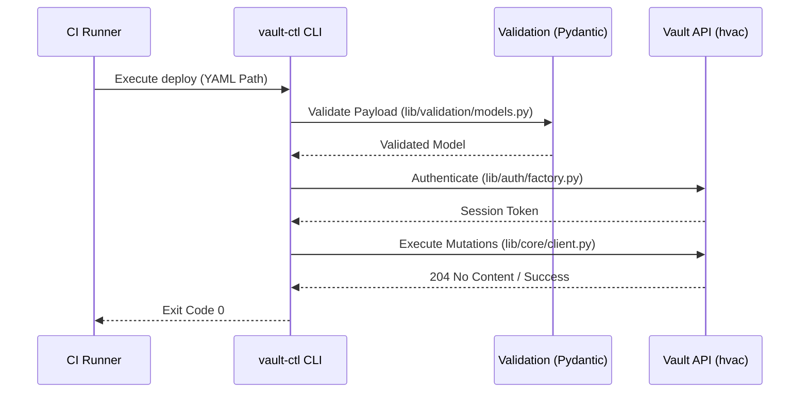

# Admin Guide

This guide details the explicit runtime mechanics, operational workflows, and failure modes of the Vault controller orchestration framework. Platform administrators maintain deterministic control over day-2 Vault tasks via modular library components.

---

## Content

- [Operational Core Mechanics & API Anatomy](#operational-core-mechanics--api-anatomy)
- [Unified Authentication & Session Management](#unified-authentication--session-management)
- [State and Execution Sequence Diagram](#state-and-execution-sequence-diagram)
- [Fault Isolation & Defensive Guardrails](#fault-isolation--defensive-guardrails)

---

## Operational Core Mechanics & API Anatomy

The controller leverages `projects.vault_controller.lib.core.client.LocalVaultClient` for all low-level cluster mutations. This client is powered by the **hvac** library, ensuring consistent timeout handling, retries, and access to native Vault API features.

```bash
# !/usr/bin/env python3
"""
Principal Infrastructure Suite: Admin Edge Orchestrator.
Utilizes the consolidated vault-ctl CLI for cluster operations.
"""

# Check health and seal status across the cluster
vault-ctl cluster status --name example_vault

# Unseal nodes using Shamir keys
vault-ctl cluster unseal --name example_vault <KEY_1> <KEY_2> <KEY_3>
```

---

## Unified Authentication & Session Management

Authentication is managed via pluggable strategies in `lib/auth/`. The controller supports the following methods:

1.  **Token**: `VAULT_AUTH_TYPE=token`, `VAULT_AUTH_SECRET=<TOKEN>`
2.  **LDAP**: `VAULT_AUTH_TYPE=ldap`, `VAULT_AUTH_PRINCIPAL=<USER>`, `VAULT_AUTH_SECRET=<PASS>`
3.  **AppRole**: `VAULT_AUTH_TYPE=approle`, `VAULT_AUTH_PRINCIPAL=<ROLE_ID>`, `VAULT_AUTH_SECRET=<SECRET_ID>`
4.  **AWS/GCP**: Cloud-native identity handshakes leveraging `hvac`'s specialized auth methods.

The `AuthStrategyFactory` dynamically selects the strategy, which then configures the underlying `hvac.Client` instance within the `LocalVaultClient`.

---

## State and Execution Sequence Diagram

The following sequence diagram illustrates the idempotent reconciliation loop executed by `vault-ctl secrets deploy`.



---

## Fault Isolation & Defensive Guardrails

### 1. Pydantic Enforcement
The `ValidationManager` utilizes **Pydantic** models to perform pre-flight checks. Any payload violating schema or business rules (e.g., mixing read/write capabilities in a single policy path) is rejected before any network calls are made.

### 2. Namespace Sovereignty
Deployment logic enforces directory-to-namespace parity. Configuration for `namespaces/app1/` must specify `_namespace: app1` in the YAML, or the `ValidationManager` will raise a mismatch error.

### 3. Verification Metrics
Every administrative run must be verified via `pytest`.

```bash
# Verify administrative configuration against example_vault
pytest projects/vault/tests/integration/test_admin_ops.py
```

---
**Navigation**
- [Introduction](01_VAULT_INTRODUCTION.md)
- [User Workflows](03_USER_WORKFLOWS.md)
- [Developer Guide](04_DEVELOPER_GUIDE.md)
