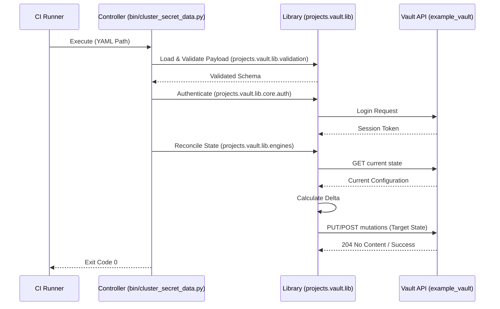

# Admin Guide

This guide details the explicit runtime mechanics, operational workflows, and failure modes of the Vault controller orchestration framework. Platform administrators maintain deterministic control over day-2 Vault tasks via modular library components.

---

## Content

- [Operational Core Mechanics & API Anatomy](#operational-core-mechanics--api-anatomy)
- [Unified Authentication & Session Management](#unified-authentication--session-management)
- [State and Execution Sequence Diagram](#state-and-execution-sequence-diagram)
- [Fault Isolation & Defensive Guardrails](#fault-isolation--defensive-guardrails)

---

## Operational Core Mechanics & API Anatomy

The controller leverages `projects.vault.lib.core.client` for all low-level cluster mutations. This ensures consistent timeout handling, retries, and unified logging across administrative tasks.

```python
# !/usr/bin/env python3
"""
Principal Infrastructure Suite: Admin Edge Orchestrator.
Utilizes projects.vault.lib for zero-trust boundary enforcement.
"""

import os
from projects.vault.lib.core.client import VaultClient
from projects.vault.lib.engines.audit import AuditManager

def setup_cluster_audit():
    # Unified Auth context
    client = VaultClient(
        addr=os.getenv("VAULT_ADDR"),
        auth_type=os.getenv("VAULT_AUTH_TYPE"),
        principal=os.getenv("VAULT_AUTH_PRINCIPAL"),
        secret=os.getenv("VAULT_AUTH_SECRET")
    )
    
    audit_manager = AuditManager(client)
    
    # Define audit device via YAML-derived payload
    config = {
        "type": "file",
        "options": {
            "file_path": "/var/log/vault/audit.log",
            "log_raw": "false"
        }
    }
    
    audit_manager.enable("syslog-device", config)
    print("[*] Audit device synchronized.")
```

---

## Unified Authentication & Session Management

Fragmented environment variables (e.g., `VAULT_TOKEN`, `VAULT_ROLE_ID`) are deprecated. All operations must utilize the Unified Auth triad:

1.  `VAULT_AUTH_TYPE`: (e.g., `aws`, `gcp`, `ldap`, `approle`, `token`)
2.  `VAULT_AUTH_PRINCIPAL`: The identity identifier (Role Name, Username, or Role ID).
3.  `VAULT_AUTH_SECRET`: The authentication credential (Secret Key, Password, or Token).

The `projects.vault.lib.core.auth` module handles the negotiation logic for these strategies, returning a time-limited session token to the client.

---

## State and Execution Sequence Diagram

The following sequence diagram illustrates the idempotent reconciliation loop executed by `bin/cluster_secret_data.py`.



---

## Fault Isolation & Defensive Guardrails

### 1. Circuit Breaking
The `projects.vault.lib.utils.http` wrapper implements exponential backoff and circuit breaking. If the cluster returns 5xx errors, the controller halts to prevent cascading failures in the CI runner.

### 2. Schema Hardening
Administrators must define regex constraints within `projects.vault.lib.validation.schema`. Any attempt to provision a policy with `sudo` capabilities on `sys/` paths will be rejected during the pre-flight validation phase.

### 3. Verification Metrics
Every administrative run must be verified via `pytest`.

```bash
# Verify administrative configuration against example_vault
pytest projects/vault/tests/integration/test_admin_ops.py
```

---
**Navigation**
- [Introduction](01_VAULT_INTRODUCTION.md)
- [User Workflows](03_USER_WORKFLOWS.md)
- [Developer Guide](04_DEVELOPER_GUIDE.md)
